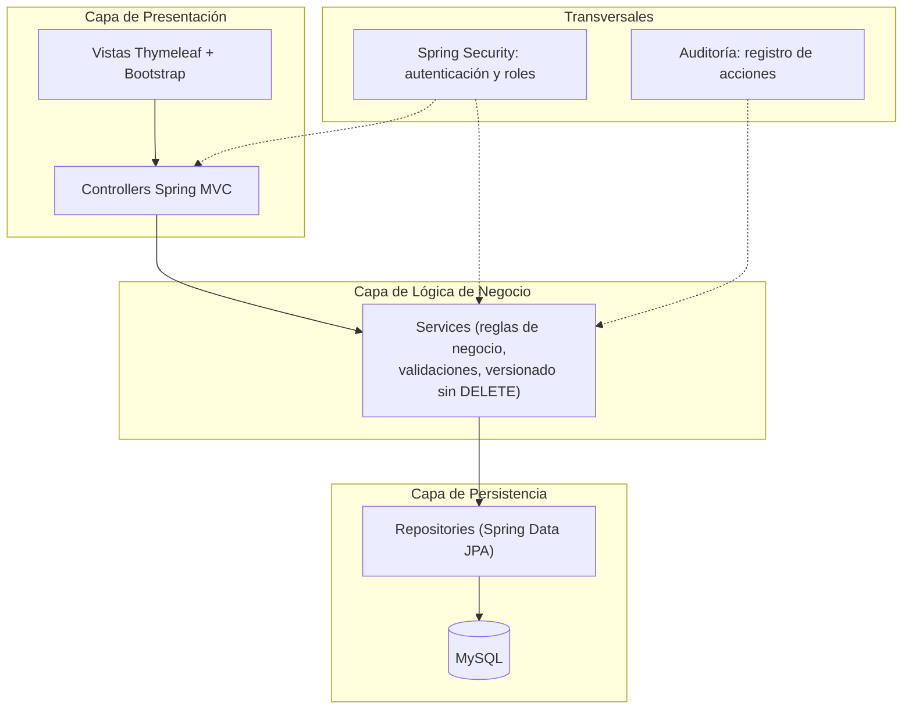

# Arquitectura del Proyecto — HCE Pabellón de Salud Mental

## 1. Arquitectura elegida: monolito modular en capas (MVC)

Se descarta una arquitectura de microservicios: el equipo es de dos personas, el plazo es
académico y el sistema va a ser usado por un número acotado de profesionales dentro de un
único pabellón (decenas de usuarios concurrentes, no miles). Separar el sistema en servicios
distribuidos agregaría complejidad operativa (orquestación, comunicación entre servicios,
despliegue de múltiples piezas) sin resolver ningún problema real del proyecto — sería
sobreingeniería, tal como se define en el material de la cátedra: una arquitectura
tecnológicamente vistosa pero que no responde al escenario real analizado.

En su lugar, se adopta un **monolito modular organizado en capas**, con el patrón **MVC**
provisto por Spring Boot + Thymeleaf:

Cada módulo funcional del listado anterior (Guardia, Internación, Diagnóstico, Evolución,
Medicación, Permisos, Egreso) se implementa como un paquete propio que atraviesa las tres
capas (su controller, su service, su repository, sus entidades), en vez de organizar el código
por capa como se venía haciendo. Esto es lo que permite trabajar por recorridos verticales:
cada sprint entrega uno o más paquetes completos y funcionales de punta a punta.

## 2. Tecnologías definitivas

| Componente | Tecnología | 
|---|---|
| Lenguaje / plataforma backend | Java + Spring Boot |
| Persistencia / ORM | Spring Data JPA (Hibernate) sobre MySQL |
| Seguridad | Spring Security (autenticación + autorización por rol) |
| Vistas | Thymeleaf |
| Frontend (estilos/maquetado) | HTML5, CSS3, Bootstrap |
| Base de datos | MySQL |
| Despliegue | Render (PaaS) |
| Control de versiones | Git / GitHub |

No hay cambios respecto de la propuesta original; esta sección formaliza y justifica esas
decisiones ya tomadas.

## 3. Justificación de las decisiones técnicas

**¿Por qué Java + Spring Boot para el backend?** El sistema tiene entidades fuertemente
relacionadas (paciente, internación, diagnóstico, medicación, evolución) y reglas de negocio no
triviales (versionado sin DELETE, permisos por rol, distintos orígenes de una misma acción).
Spring Boot da una separación clara entre controller/service/repository que ordena esa
complejidad, y Spring Security resuelve de forma madura el control de acceso por rol que pide
el proyecto. Es, además, la tecnología con la que el equipo ya tiene experiencia previa (ver
tabla de conocimiento del equipo, sección 5), lo que reduce el costo de aprendizaje en un
proyecto con fecha de entrega fija.

**¿Por qué no otro framework backend?** Node.js/Express tendría sentido si el sistema
necesitara alta concurrencia en tiempo real (chat, notificaciones push); no es el caso. Python/
Django encajaría mejor si hubiera componentes de procesamiento de datos o ML; tampoco es
el caso. Java/Spring es la opción sólida para "aplicaciones web con lógica de negocio
compleja", que es exactamente el escenario del proyecto.

**¿Por qué MySQL (relacional) y no NoSQL?** Los datos tienen una estructura bien definida y
estable (paciente, internación, diagnóstico, medicación, evolución) y las relaciones entre esas
entidades son el corazón del modelo (un paciente con N internaciones, una internación con N
diagnósticos/evoluciones/indicaciones). Además se necesita integridad transaccional: una
indicación de medicación y su administración no pueden quedar inconsistentes entre sí. Estas
son exactamente las condiciones en las que el material de la cátedra recomienda una base
relacional por sobre una documental.

**¿Por qué Thymeleaf en vez de un framework de frontend separado (React/Angular)?**
Thymeleaf permite generar las vistas integradas con el backend de Spring sin sumar un
proyecto frontend adicional, ni una API REST separada solo para consumo propio. Para el
alcance de este proyecto (una interfaz web sencilla, sin necesidad de una SPA con
interactividad compleja) esto mantiene el stack acotado, tal como se justificó en la propuesta
original, evitando sumar una tecnología más para aprender y mantener.

**¿Por qué Render (PaaS)?** El equipo no tiene la necesidad ni el tiempo de gestionar un
servidor propio durante la cursada. Render permite desplegar directamente desde el
repositorio sin administrar infraestructura, a costa de menor control — un costo aceptable dado
que se trata de un prototipo académico y no de un sistema productivo con requisitos de
performance o disponibilidad estrictos.

**¿Experiencia previa del equipo con estas tecnologías?** Ver sección 5 — a completar por el
equipo, ya que es autoevaluación de conocimiento y no algo que pueda definirse desde el
diseño.

## 4. Cómo se traduce el diseño de datos en la arquitectura

- El versionado sin `DELETE` (diagnósticos, indicaciones, evoluciones) se resuelve en la **capa
  de servicio**: el método de "modificar" nunca hace `UPDATE` destructivo, siempre inserta un
  registro nuevo y marca el anterior como reemplazado/corregido.
- La **auditoría transversal** se implementa como un componente aparte (interceptor o aspecto)
  que registra, para cada operación relevante, quién la hizo y cuándo — sin mezclar ese código
  dentro de cada service de cada módulo.
- Los **roles** (médico de guardia, profesional tratante, enfermería) se modelan con Spring
  Security a nivel de controller/endpoint, apoyados en la tabla `ROL` del modelo de datos.

## 5. Conocimiento previo del equipo (a completar)

Tal como pidió Oscar, para validar la viabilidad temporal hace falta este detalle por integrante.
Les dejo la tabla lista para completar antes de subirla al repo:

| Tecnología | Miguel | Joaquín |
|---|---|---|
| Java | | |
| Spring Boot | | |
| Spring Security | | |
| MySQL | | |
| HTML/CSS/JS | | |
| Bootstrap / Thymeleaf | | |
| Deployment (Render/Git) | | |

*(Niveles sugeridos por Oscar: inicial / intermedio / avanzado)*
